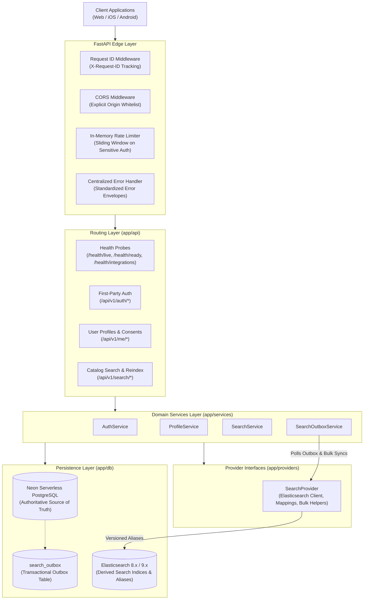
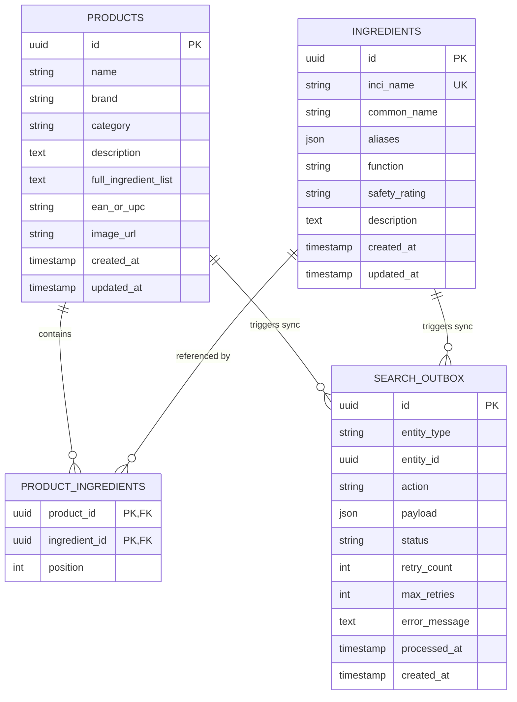

# ToneTrace AI — Architecture Document

## 1. System Mission & Scope

ToneTrace AI is an intelligent skincare companion backend designed to provide evidence-based skincare recommendations, ingredient optical character recognition (OCR), visual skin metric analysis, and cosmetic catalog search.

### Current Implementation Status (Phases 0, 1, 2, 3, 4)
- **Phase 0 Foundation**: Centralized exceptions, structured logging with correlation IDs, health & readiness probes, Pydantic settings with secret masking.
- **Phase 1 Database Layer**: SQLAlchemy 2.0 async engine via Psycopg 3, Alembic migrations, dual-URL Neon pooling architecture.
- **Phase 2 First-Party Authentication & Profiles**:
  - Direct first-party auth (Argon2id, PyJWT, rotating refresh tokens with replay attack family revocation).
  - User profiles, skin profiles, sensitivities, preferences, and GDPR/CCPA-compliant consent audit tracking.
- **Phase 3 Elasticsearch Search Foundation**:
  - Official Elasticsearch Python client with TLS and API key authentication.
  - PostgreSQL as single authoritative source of truth.
  - Transactional Outbox pattern (`search_outbox`) for reliable, retryable synchronization.
  - Versioned indices (`tonetrace_products_v1`, `tonetrace_ingredients_v1`) bound to stable aliases (`tonetrace_products_current`, `tonetrace_ingredients_current`).
  - Edge-ngram autocomplete and skincare text analyzers.
  - Full catalog reindexing pipeline from PostgreSQL into Elasticsearch.
- **Phase 4 Product and Ingredient Catalogue**:
  - Provenance-aware cosmetic formulations with Open Beauty Facts v2 adapter (ODbL v1.0).
  - Formula versioning preserving historical formulations rather than overwriting on reformulation.
  - Commercial offer separation: storing prices in integer minor units (e.g. cents) away from scientific formulation data.
  - Channel3 retail API contract adapter with honest unconfigured handling.

---

## 2. High-Level Architecture Diagram

---

## 3. Database Schema (Entities & Outbox)

---

## 4. Key Architectural Decisions (Phase 3)

### 4.1 PostgreSQL as Source of Truth & Elasticsearch as Index
Elasticsearch is treated strictly as a rebuildable index, never as primary storage. If an Elasticsearch node or index fails or is deleted, running `POST /api/v1/search/reindex` will read from PostgreSQL and rebuild the search index in its entirety.

### 4.2 Transactional Outbox Pattern
Directly sending writes to two different systems (PostgreSQL and Elasticsearch) inside an API request risks split-brain inconsistencies (e.g. Postgres commits, but the Elasticsearch network call fails). By inserting an event into `search_outbox` in the same database transaction as the business entity, consistency is guaranteed. The `SearchOutboxService` batches events and pushes them to Elasticsearch with document-level error tracking and exponential backoff retries.

### 4.3 Versioned Indexing & Aliases
To allow zero-downtime index migrations and analyzer changes in the future, the application always reads from and writes to stable aliases (`tonetrace_products_current`, `tonetrace_ingredients_current`) that point to concrete physical indices (`tonetrace_products_v1`, `tonetrace_ingredients_v1`).

---

## 5. Key Architectural Decisions (Phase 4 Catalogue)

### 5.1 Historical Formula Preservation & Provenance
Cosmetic products frequently undergo reformulations without changes to commercial branding or packaging names. To prevent corruption of historical user skin diary entries and analysis correlations:
- Reformulations append a new `ProductIngredientList` with an incremented `formula_version` rather than updating or deleting prior records.
- Prior formulas are preserved with `is_current = false`.
- Every formula record links to its originating `DataSource` and records the exact observation timestamp `retrieved_at` alongside the raw ingredient declaration.

### 5.2 Strict Commercial Separation & Integer Minor Currency Units
Commercial retail availability (merchant name, purchase URL, stock status, and price) is strictly separated from scientific formulation data. Prices are stored exclusively as integer minor currency units (e.g. `1999` for `$19.99` USD) to prevent floating-point rounding errors and currency truncation.

### 5.3 Zero Data Fabrication & Resilient External Adapters
- **Open Beauty Facts**: Uses the official v2 API (`/api/v2/product/{barcode}.json`) with custom `User-Agent` and ODbL v1.0 attribution metadata. Missing fields remain `None` rather than fabricated. Status 429 triggers `OpenBeautyFactsRateLimitError` and upstream downtime triggers `OpenBeautyFactsUnavailableError`.
- **Channel3**: Bound behind a dedicated provider adapter. When `CHANNEL3_API_KEY` is not present, the system honestly reports `is_configured = False` and rejects calls with `Channel3NotConfiguredError`, refusing to fabricate mock endpoints or fake contracts.

---

## 6. Key Architectural Decisions (Phase 5 OCR & Label Scanning)

### 6.1 Private Object Storage & Signed URLs
Product label scans may contain sensitive user background details or private photos. Files are never stored under public web roots or exposed via static public URLs:
- `LocalStorageProvider`: Stores files in an unexposed local directory with strict path-traversal immunity (`ValueError` raised if paths escape root). Viewing URLs are generated using HMAC-SHA256 signatures with expiration timestamps (`exp`), validated in constant time via `hmac.compare_digest`.
- `S3StorageProvider`: Built for S3-compatible cloud object storage (e.g. Cloudflare R2), generating time-bounded pre-signed URLs.

### 6.2 Multi-Adapter Replaceable OCR Architecture
- **Online OCR (OCR.space Free API)**: Live verification confirmed the user's provided credentials map to the OCR.space Free API at `https://api.ocr.space/parse/image`. The adapter implements multipart form upload, handles HTTP 429 rate limits, and extracts execution timings.
- **Local OCR (Tesseract)**: Engine candidate checking for local binary availability and reporting diagnostic guidance when not installed.
- **Deterministic Mock**: High-confidence deterministic responses for automated test suites and offline local development.

### 6.3 Untrusted Text Handling & Candidate Segmentation
- OCR output is inherently error-prone and untrusted. The full raw text is quarantined in `ocr_jobs.raw_text` and preserved unmodified.
- Candidate ingredients are conservatively segmented by commas, semicolons, bullets, and line breaks while stripping packaging boilerplate (e.g. "Active Ingredients:", percentages, asterisks).
- Segmented candidates are automatically cross-referenced against authoritative PostgreSQL `ingredients` (by INCI or common name) and `ingredient_aliases`. Unmatched items remain unverified candidates.

### 6.4 Human-in-the-Loop Review & Strict Data Isolation
- Scanned ingredient lists are provisional until explicitly reviewed and confirmed by the user via `POST /api/v1/ocr/scans/{scan_id}/confirm`.
- Users can modify normalized names, correct OCR misreadings, and add omitted ingredients.
- All media assets and scan jobs enforce strict tenant isolation (`job.user_id == current_user.id`), returning HTTP 404 on any unauthorized cross-user inspection or confirmation attempts.

---

## 7. Key Architectural Decisions (Phase 6 Ingredient Evidence & Research Retrieval)

### 7.1 Four-Way Epistemic Separation
To prevent conflating regulatory listings, raw abstracts, reviewed clinical summaries, and commercial marketing copy, `ingredient_evidence` enforces four distinct categories (`evidence_category`):
1. `identity_reference`: European Commission CosIng nomenclature, CAS/EC numbers, recognized cosmetic functions, and Annex restrictions.
2. `published_research`: Peer-reviewed PubMed bibliographic records and abstracts.
3. `human_interpretation`: Authored, human-reviewed dermatological interpretations with explicit limitations and caveats.
4. `marketing_claim`: Commercial brand claims, automatically forced to `evidence_direction = "reference_only"` and `evidence_strength = "reference_only"`.

### 7.2 Scientific Honesty & Non-Fabrication Guardrails
- **No Full-Text Fabrication**: PubMed E-utilities (`efetch.fcgi`) provides bibliographic metadata and abstracts only; `research_records.has_full_text` is strictly `False`. Records lacking an abstract are stored with `abstract_text = None` and classified as `insufficient`.
- **Derivative vs. Exact INCI Matching**: Both `CosIngAdapter` and `PubMedAdapter` verify whether a retrieved record matches the target ingredient exactly (`NIACINAMIDE`) or represents a derivative/compound (`NIACINAMIDE/YEAST POLYPEPTIDE`), flagging non-exact matches as `incorrect_match_flagged`.
- **Mandatory Epistemic Disclaimers**: Every `GET /api/v1/ingredients/{ingredient_id}/evidence` response includes `epistemic_guardrails` stating that efficacy cannot be claimed from ingredient name alone, concentration cannot be inferred from packaging order, and causation cannot be inferred from a scan.

### 7.3 Database Caching & Idempotent Deduplication
- Ordinary `GET /api/v1/ingredients/{ingredient_id}/evidence` requests read exclusively from PostgreSQL and never trigger external HTTP requests.
- `POST /api/v1/ingredients/{ingredient_id}/evidence/refresh` enforces authentication, rate limiting, and `EVIDENCE_CACHE_TTL_HOURS` caching (unless `force_refresh=True`), deduplicating `research_records` by `(source_type, external_id)`.

---

## 9. Gemini-Powered Grounded Explanations Architecture (Phase 7)

### 9.1 Provider Abstraction & Reliability
- `LLMExplanationProvider` (`app/providers/gemini.py`) decouples domain grounding logic from any specific model vendor.
- `GeminiExplanationProvider` uses the official `google-genai` SDK (`client.aio.interactions.create`) with `store=False`, `response_format={"type": "text", "mime_type": "application/json", "schema": ...}`, bounded retries for transient `5xx`/timeouts, and graceful `429` free-tier quota handling without switching silently to paid providers.

### 9.2 Grounding Verification & Prompt Injection Isolation
- Retrieved product descriptions, marketing claims, and OCR raw text are sanitized and enclosed in `<untrusted_data>...</untrusted_data>` blocks so they cannot override system instructions.
- Every finding returned by Gemini must cite source IDs from `allowed_sources` (`prod:<uuid>`, `ing:<uuid>`, `ev:<uuid>`, `res:<uuid>`, `offer:<uuid>`, `ocr:<uuid>`).
- Any fabricated source ID, invented concentration percentage, invented price, or diagnostic claim triggers deterministic fallback synthesis (`grounding_status="fallback_applied"`).

---

## 10. Skin Analysis & Longitudinal Skin Story Architecture (Phase 8)

### 10.1 Provider Abstraction & S2S Workflow
- `BaseSkinAnalysisProvider` (`app/providers/skin_analysis.py`) defines the contract for submitting facial images and polling asynchronous tasks.
- `YouCamSkinAnalysisAdapter` implements the verified Perfect Corp YouCam S2S v2.0 API (`POST /s2s/v2.0/file/skin-analysis`, pre-signed PUT upload, `POST /s2s/v2.0/task/skin-analysis`, and `GET /s2s/v2.0/task/skin-analysis/{task_id}`).
- `MockSkinAnalysisAdapter` provides deterministic, SHA-256-derived visual metrics for offline tests. Provider failures or timeouts always transition the scan and job to `status="failed"` and never fabricate a successful scan.

### 10.2 Consent, Private Storage, and Longitudinal Comparability
- `SkinService` verifies an active `UserConsent` (`skin_data_processing` or `facial_scan_processing`) before storing any image in private object storage (`scan_media`) or creating `analysis_jobs` and `skin_scans`.
- `SkinObservation` stores normalized metric codes, raw values, display values, units, directionality, `provider_model_version`, and `interpretation_version` separately from restricted raw provider responses (`raw_payload_retained=False`).
- `GET /api/v1/skin/story` computes longitudinal deltas exclusively across observations with matching `unit`, `provider_name`, `provider_model_version`, and `interpretation_version`, flagging incompatible points and framing all deltas as non-clinical camera observations subject to lighting, camera, angle, and cosmetics variability.

---

## 11. My Shelf & Product Discovery Architecture (Phase 9)

### 11.1 Personal Shelf & Reaction Isolation
- `UserProduct` (`user_products`) stores both catalogue-linked products (`product_id`) and custom products (`is_custom=True`), preserving snapshot `custom_name` and `custom_brand` so items remain readable (`catalogue_status="catalogue_unavailable"`) even if a public catalogue record is removed.
- `ProductReaction` (`product_reactions`) records user-reported tolerance or adverse reactions (`irritation`, `redness`, `breakout`, `stinging`, `allergic_suspect`) and suspected ingredients, which feed directly into `DiscoveryService` exclusion rules.

### 11.2 Hybrid Discovery & Versioned Suitability Engine
- `DiscoveryService` (`app/services/shelf_service.py`) queries Elasticsearch when enabled (following `ELASTICSEARCH_FALLBACK_TO_DB` on outage) and hydrates authoritative records from PostgreSQL.
- Every product is evaluated by `tonetrace-discovery-rules-v1.0` (`R1` completeness, `R2` sensitivity/reaction exclusion, `R3` goal & non-marketing evidence alignment, `R4` skin type fit, `R5` commercial offer segregation), with optional grounded Gemini explanations via `ExplanationService`.

---

## 12. Routines, Reminders & Reactions Architecture (Phase 10)

### 12.1 Mutable Routine Definitions vs. Immutable Completion History
- `Routine` (`routines`) and `RoutineStep` (`routine_steps`) define ordered skincare steps (`step_order`) referencing user-owned shelf items (`user_product_id`), public catalogue products (`product_id`), or custom instructions (`custom_instruction`).
- Editing a routine increments `Routine.version`. `RoutineCompletion` (`routine_completions`) records `routine_name_snapshot`, `routine_version_snapshot`, `completed_steps_snapshot`, `user_timezone`, `local_date`, and `local_time` so editing or deleting a routine never erases historical completion records.

### 12.2 Notification Provider & Idempotent Reminder Dispatch
- `BaseNotificationProvider` (`app/providers/notification.py`) abstracts notification delivery. For local development and testing, `LocalRecordingNotificationAdapter` captures messages in memory and PostgreSQL (`ReminderDeliveryRecord`) with `is_simulated=True`, `actual_external_delivery=False`, and `status="recorded_local_not_sent"`.
- `ReminderService` enforces user opt-outs (`reminders_enabled`), local quiet hours (`quiet_hours_start`..`quiet_hours_end`) evaluated in the user's IANA timezone, idempotency deduplication (`uq_reminder_deliveries_user_idempotency`), and delivery failure capture.

### 12.3 Safety-Aware Product Reactions
- `ReactionService` (`app/services/routine_service.py`) treats all `ProductReaction` entries as user-reported observations (`is_causal_proof=False`, `is_medical_diagnosis=False`).
- When severe or rapidly worsening reactions are reported (`severity="severe"`, `is_rapidly_worsening=True`, or red-flag symptoms such as facial/lip swelling, hives, or blistering), the service surfaces immediate urgent-care guidance (`requires_urgent_care_guidance=True`) and suspends ordinary product recommendations (`ordinary_recommendations_suspended=True`).

